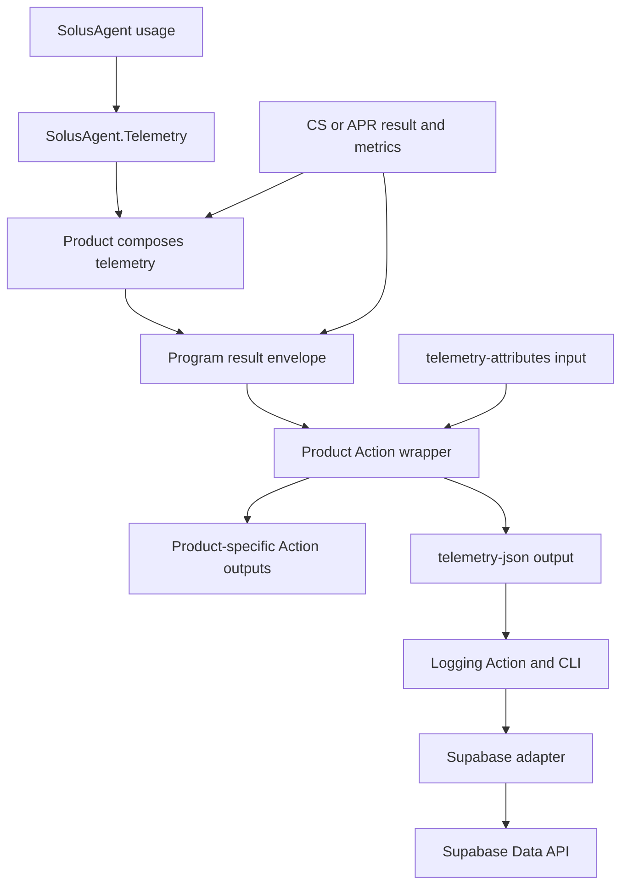

# L1: Consumable telemetry and logging prerelease

Status: selected planning proposal from the maintainer discussion; no implementation, publication, downstream migration or live qualification is claimed. This document defines the first independently consumable experimental release. The Agent runtime and Logging delivery tracks share a repository but retain separate solutions, dependency graphs and release selection.

Delivery tracking: [L1 milestone](https://github.com/SolusQuest/solus-agent/milestone/6) and [delivery parent #116](https://github.com/SolusQuest/solus-agent/issues/116). The parent owns the reviewed issue graph and acceptance progress. The documentation PR establishes the proposed design baseline; its merge remains maintainer-owned.

## Outcome and ownership

Publish versioned telemetry libraries and a usable logging GitHub Action. Clean Scribe-shaped and APR-shaped consumers install the released libraries, generate the same public telemetry format, expose it through an Action output, and invoke the released logging Action to persist and read back numeric usage and custom fields in Supabase. Full CS/APR integration, product releases and their downstream workflow rollout remain downstream-owned work, not conditions for closing L1.

The first supported execution target is managed .NET 10 on Ubuntu 24.04 x64. The Action invokes a published CLI payload; the consuming workflow does not compile this repository. Ordinary development and CI use synthetic inputs and controlled transport without database, registry or model credentials. Package publication and bounded live storage qualification are separate externally authorized operations.

## Projects and solutions

| Project | Responsibility | Direct production references | Distribution |
| --- | --- | --- | --- |
| `Solus.Telemetry.Contracts` | Backend-neutral immutable records, versioned JSON, extension validation and bounded serialization | None | NuGet |
| `SolusAgent.Telemetry` | Explicit mapping of `SolusAgent.Api` usage into public telemetry; no upload or product policy | `SolusAgent.Api`, `Solus.Telemetry.Contracts` | NuGet |
| `Solus.Logging` | Sink interface, bounded delivery, retry classification and delivery result | `Solus.Telemetry.Contracts` | NuGet |
| `Solus.Logging.Supabase` | Fixed Supabase Data API/RPC protocol, authentication and relational/JSONB mapping | `Solus.Logging`, `Solus.Telemetry.Contracts` | NuGet |
| `Solus.Logging.Cli` | Read one record, validate configuration, construct the selected sink and report delivery | `Solus.Logging`, `Solus.Logging.Supabase`, `Solus.Telemetry.Contracts` | Versioned executable archive |

`SolusAgent.slnx` contains the existing five Agent projects, `SolusAgent.Telemetry`, the shared Contracts project and Agent tests. `Solus.Logging.slnx` contains Contracts, Logging, Supabase, CLI and a Logging test runner. Contracts is one project included in both solutions. The existing Agent libraries never reference telemetry or logging. Logging never references an Agent assembly. Products reference the mapper and Contracts where directly used, alongside their existing Agent startup dependencies. No CS/APR source files or product assemblies enter this repository.

New sources use the matching names under `src/`. Logging tests live under `tests/Solus.Logging.Tests`; clean examples live under `tests/TelemetryConsumers`. The independent Logging workflow owns its build and test entrypoint. Project-boundary tests must verify actual solution membership and references, including negative forbidden edges, without reserving unimplemented projects. The legacy five-package release workflow remains independently usable.

## Telemetry v1

One immutable record represents the terminal observation of one physical product invocation. It has a producer-created UUID `eventId`, a stable `invocationId`, a UTC `occurredAt`, `product`, `productVersion`, `schemaVersion: 1`, bounded execution context, product outcome classification, `usage`, and `extensions`. Event identity is assigned once and reused across transport retries. Another actual product invocation, including a workflow rerun, gets a new event identity. Failed upload does not cause product execution to be replayed.

Execution context may include repository, workflow run ID, run attempt, job and a caller-supplied invocation key to distinguish multiple calls/matrix instances. These are labels for correlation, not authorization claims. Product outcome and telemetry delivery outcome are independent.

`usage` is an invocation envelope of bounded current run summaries, not a serialized Agent outcome or context. Each run preserves execution identity, inventory coverage, independent input/output observed count and coverage, known logical/physical attempt and tool counts where available, provider counter kind/relationship/value, and separately classified accounting observations when supplied. Mapping retains the original meaning; it does not reconstruct missing cache partitions, flatten overlapping provider counters into totals, replace missing values with zero, or turn reservations/policy charges into measurements. Int64 counters use canonical decimal strings on the JSON wire so Python, JavaScript and database transport cannot round them. Unknown values remain JSON null with their explicit coverage. A producer proves no work with a complete empty inventory; absence of a record is not zero usage.

A product invocation may contain several Agent runs. The product supplies the exact current-run collection; the mapper validates distinct identities and preserves them. History is excluded from current-run totals. Product historical accounting, when needed, is explicitly named inside its extension. Aggregate summaries may be derived only from validated current membership and coverage; no aggregate is represented as complete when membership or measurements are partial. The serializer never includes prompts, candidates, raw responses, exception bodies or saved context.

The initial bounds are a 256 KiB UTF-8 record, 32 KiB combined extensions, 64 extension properties per object, nesting depth eight and at most 256 current run summaries. The producer constructs and validates its bounded record before exposing output. An over-limit or otherwise invalid record produces an explicit telemetry-unavailable diagnostic and no partial/truncated record; it does not change the product's business result. Limits are contract constants with boundary tests. Detailed attempt histories and streaming events are outside L1.

## Extension ownership

`extensions` is a JSON object with named object namespaces. CS owns `extensions.scribe`; APR owns `extensions.apr`; the consuming workflow owns `extensions.caller`. Additional products own their documented namespace. Values support bounded JSON objects, arrays, strings, booleans, null and interoperable finite numbers; integers requiring precision beyond JavaScript's safe integer range use strings. Duplicate JSON member names, reserved-field overrides and invalid namespaces are rejected. The public record owns an immutable copy of the extension data.

The shared library validates structure and bounds rather than each product's field vocabulary. The wrapper adds caller attributes only to `extensions.caller`; it cannot overwrite identity, usage or the product namespace. Non-JSON values and silent coercion are not supported. No sink may silently drop admitted extension fields. Storing a number does not assign it an aggregation rule: per-invocation increments, historical snapshots and ratios retain producer-defined semantics.

Example extensions:

```json
{
  "apr": {"findingCount": 3, "publicationStatus": "published"},
  "caller": {"team": "platform", "costCenter": "engineering"}
}
```

## Product and Action flow



The proposed common product Action input is `telemetry-attributes`, a caller JSON object. The proposed common output is `telemetry-json`. CS/APR retain their business outputs. Overlapping legacy usage outputs derive from the same admitted observation when scope and meaning match; historical campaign accounting is not replaced by current run usage. The new mapping happens in the .NET product layer before the older output projections can lose information. The wrappers handle GitHub output and caller attributes; the shared .NET libraries have no ambient `GITHUB_OUTPUT` behavior. L1 supplies executable product-shaped examples and an integration guide, not patches to either product repository.

The logging Action accepts `telemetry-json`, `adapter: supabase`, endpoint and credential inputs, and an optional strict-delivery policy. It validates all inputs before network access. It exposes `delivery-status` (`stored`, `duplicate`, `skipped`, `failed`) and a bounded diagnostic code. Empty input is `skipped` with an unavailable-input diagnostic, never stored as zero usage. Nonempty invalid input and authentication/schema failures are reported as failed, not retried as transient faults. Transient network/429/5xx cases use a finite attempt/time budget and cancellation. Default delivery failure warns without changing the previous product result; explicit strict mode fails the logging step. No action or library reexecutes CS/APR.

The caller uses a post-product step with a finite timeout and an explicit status condition such as `always()`. Product failure may retain usable telemetry. Cancellation, hard kill or runner loss can prevent final output or upload; L1 offers best-effort terminal reporting, not a durable billing ledger. Multi-job file transfer, streaming, a background daemon and exactly-once delivery are outside scope.

## Supabase storage and authorization

The first adapter targets a caller-owned Supabase project through its existing Data API, not a new hosted logging service. A publishable API key plus an externally supplied access JWT for a dedicated ingest identity authenticate requests. Token provisioning/refresh is owned by the operator; expired credentials produce an explicit failure. The Action receives only those inputs, never discovers ambient database credentials, and never accepts arbitrary table names or SQL. Registry credentials and storage credentials remain separate.

The deterministic schema artifact defines a fixed `telemetry_events` table and a fixed `ingest_telemetry` RPC. `writer_id` comes from the authenticated identity and is not trusted from the event or extensions. RLS restricts insert and readback to that identity; anonymous writes, caller-selected writer identities, update and delete are not granted. The RPC uses invoker permissions and an explicit safe search path. Operators apply the reviewed migration to their selected project; normal logging runs never apply migrations. No shared service-role credential is distributed to consumer projects.

Illustrative relational shape (the executable migration also supplies grants, RLS, validation and the ingest RPC):

```sql
create table public.telemetry_events (
  writer_id uuid not null default auth.uid(),
  event_id uuid not null,
  schema_version integer not null check (schema_version = 1),
  product text not null,
  product_version text not null,
  invocation_id text not null,
  occurred_at timestamptz not null,
  received_at timestamptz not null default now(),
  execution jsonb not null,
  outcome jsonb not null,
  usage jsonb not null,
  extensions jsonb not null default '{}'::jsonb,
  primary key (writer_id, event_id),
  check (jsonb_typeof(extensions) = 'object')
);
create index telemetry_events_product_time
  on public.telemetry_events (writer_id, product, occurred_at);
```

Common scalar columns support filtering; `usage` preserves structured numeric semantics; `extensions` preserves product/caller objects. No per-product table or column is required. JSONB is a backend mapping, not part of the public .NET contract. Optional JSONB indexes are added only for an observed query need.

The ingest RPC atomically inserts the first `(writer_id, event_id)`. An exact semantic duplicate returns `duplicate`; the same identity with different immutable data returns a fixed conflict and never overwrites the first record. Equality is based on normalized stored typed fields and JSONB values, excluding server-assigned `received_at`. A concurrent duplicate and a lost successful response followed by retry have the same behavior. A collision is not counted as successful delivery. Adapter, migration and tests implement this invariant together. Readback qualification uses a credential with access to the same rows and verifies original nulls, coverage, counter relationships and nested extensions.

## Distribution and compatibility

The four new libraries are internal experimental NuGet packages on the existing authorized registry; the CLI is a versioned executable payload acquired by the public repository's Action wrapper through a documented authorized path. There is no public binary/license grant implied by source visibility. Release preparation selects and documents the exact payload location, read credential if needed, integrity digest and authorized consumer access; an Action reference alone is not evidence of payload availability. A Linux x64 self-contained managed CLI archive may remove the caller SDK prerequisite without changing the managed-code requirement.

The Logging track has an independent experimental version. Its neutral libraries and CLI are released as a tested set. `SolusAgent.Telemetry` declares its compatible Contracts and Agent API package versions; it does not force an Agent core rerelease when only the storage adapter changes. Registry source mappings cover both `Solus.*` and `SolusAgent.*`. Clean verifiers pin the selected dependency set explicitly, without applying the old five-package same-version rule to every new package. Published versions and selected Action/CLI identities are immutable.

Package version and wire schema version are separate. Breaking wire semantics increment the discriminator; existing stored rows retain their original version and are not rewritten. This experimental release does not promise general upgrade compatibility or old-version readers; actual retained-data obligations must be disclosed before changing the accepted format. Unsupported schema versions fail before upload. Configuration examples pin reviewed Action commits and released package/payload versions.

## Delivery outcomes and gates

1. A runnable neutral contract/validation foundation and separate Logging solution, with architecture checks that preserve the existing Agent graph.
2. A tested Agent mapper and clean product-shaped data construction, including multiple current runs, partial usage and historical separation.
3. A callable bounded Logging/Supabase implementation, schema/RLS/RPC artifacts and deterministic storage/protocol tests; this is useful independently of GitHub Actions.
4. A packaged CLI and reusable logging Action, with real wrapper/CLI tests over controlled transport and explicit outputs/failure policy.
5. Release preparation and clean installed-package/Action consumer qualification for both product shapes; credentials are unnecessary and the artifacts are ready for publication.
6. Separately authorized publication, exact registry/payload access readback and actual CS/APR repository-token package installation evidence.
7. Separately authorized bounded live GitHub Actions-to-Supabase qualification of the published artifacts, including readback, duplicate handling and extension preservation.

Each outcome carries its tests and docs. Development never claims registry installation or live service proof. External operations wait for exact target/source/version/credential authority; issue creation and the current planning task do not authorize release, deployment, settings changes, paid resources or model calls. The live operation uses synthetic safe records in an operator-selected destination, reports a finite row/request/time budget and records cleanup ownership without deleting preexisting data.

L1 closes only when published immutable artifacts, actual access and the bounded real storage path are verified. Source builds, local packages and transport fakes are necessary intermediate evidence, not substitutes. The delivery parent remains open after graph refinement and coordinates shared contract changes, package compatibility, access dependencies and the final acceptance matrix.

## Exclusions and downstream handoff

Full CS/APR migration or product release, shared multi-tenant ingestion hosting, dynamic plugin discovery, dashboards, streaming/per-attempt log capture, additional adapters/platforms, billing reconciliation, arbitrary-kill durability and public stable compatibility are outside L1. The downstream handoff provides the exact package/Action versions, proposed common input/output names, shared usage mapping, extension ownership, legacy-output reconciliation guidance, configuration examples and observed support limits.

## Precedent

The existing Agent package-consumption and M5 release records establish clean installation and declared-support evidence without requiring full downstream migration. GitHub Actions outputs support explicit step-to-step data transfer. Supabase documents JSONB for variable-schema data and RLS for scoped database access. These precedents justify a small data contract plus a separate uploader rather than adding storage authority to the Agent runtime.

- [GitHub workflow commands](https://docs.github.com/en/actions/reference/workflows-and-actions/workflow-commands)
- [Supabase JSON and JSONB](https://supabase.com/docs/guides/database/json)
- [Supabase row-level security](https://supabase.com/docs/guides/database/postgres/row-level-security)
- [Supabase database functions](https://supabase.com/docs/guides/database/functions)
